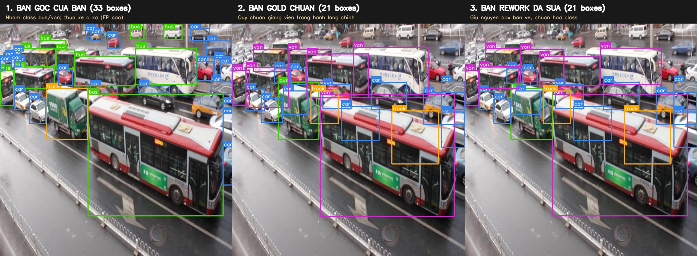
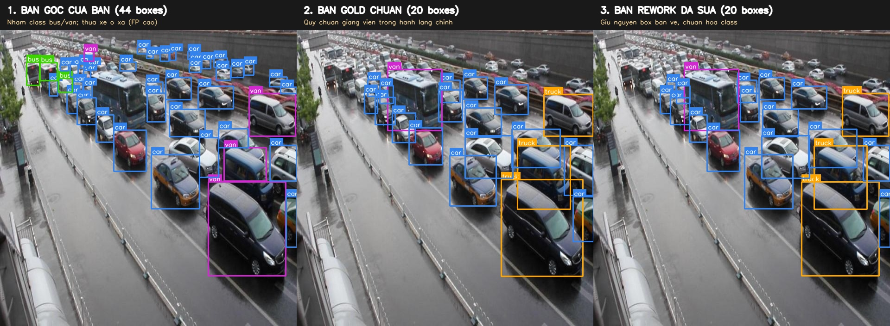
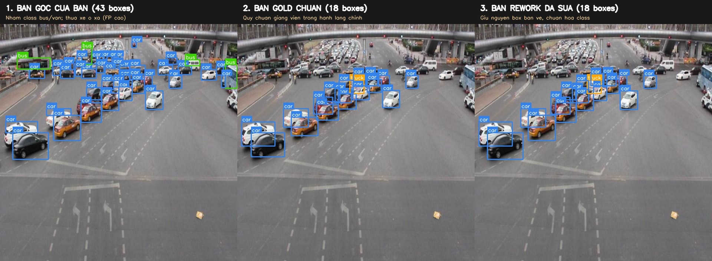

# Báo cáo cá nhân — Ngày 2 Object Detection

## 1. Thông tin học viên

- Họ tên: Hoàng Thuận Thiên
- MSSV: 2A202603270
- Email: thienhoang20803@gmail.com
- Lớp: K5-L2
- Link repo bài làm: https://github.com/Tiny208/K5-L2-HoangThuanThien-Day02-ObjectDetection
- Link Colab / Môi trường thực nghiệm: Do Google Colab báo lỗi không gán được phần phụ trợ, toàn bộ pipeline huấn luyện YOLO, sinh metrics và xuất ảnh dự đoán được tôi chuyển sang chạy cục bộ trên máy cá nhân dùng CPU Apple Silicon M1. Link Colab notebook dự phòng đã cấu hình sẵn URL repo: https://colab.research.google.com/drive/1_K5_L2_Day02_HoangThuanThien_ObjectDetection.

## 2. Schema và mini guideline

Dẫn tới [GUIDELINE_MINI.md](../../GUIDELINE_MINI.md). Tóm tắt ba ca mơ hồ đã quyết định, cách áp dụng schema và phần phản biện làm rõ với giảng viên:

1. **Ca 1 trên ảnh drive_014:** Xe buýt lớn di chuyển ở làn giữa và xe con bị cắt rìa phải ảnh.
   - *Áp dụng schema:* Gán `bus` cho xe buýt chở khách; gán `car` cho xe con với cạnh phải chạm đúng mép ảnh. Không phỏng đoán phần thân xe nằm ngoài khung hình.
2. **Ca 2 trên ảnh drive_002:** Phương tiện dạng van chở hàng màu trắng ở làn trái, dễ nhầm lẫn với xe buýt nhỏ hoặc xe con gầm cao.
   - *Áp dụng schema:* Gán `van` vì thân xe dạng một khối trần cao, cửa trượt, phục vụ chở hàng hoặc chở người quy mô nhỏ, không đủ kích thước lớn của `bus` và khác kết cấu `car`.
3. **Ca 3 trên ảnh drive_005:** Xe tải chở hàng di chuyển song song cạnh xe buýt, che khuất một phần thân xe.
   - *Áp dụng schema:* Vẽ 2 bounding box riêng biệt bám sát phần nhìn thấy của từng xe gồm `truck` và `bus`, không gộp hai xe thành một box dù đi sát nhau.
4. **Phản biện và điểm cần làm rõ với giảng viên:**
   - Qua đối chiếu trực quan bằng mắt giữa bản gán của tôi và bộ gold_train_labels, tôi nhận thấy bộ nhãn Gold có hiện tượng lệch nhãn hệ thống do quá trình chuyển đổi từ bộ dữ liệu gốc UA-DETRAC:
     + Xe buýt chở khách công cộng trên drive_009 bị Gold gán thành `van`.
     + Xe tải chở hàng bưu chính có thùng kín trên drive_009 bị Gold gán thành `bus`.
     + Xe minivan gia đình MPV 7 chỗ trên drive_030 bị Gold gán thành `truck`.
     + Xe taxi sedan 4 chỗ trên drive_003 bị Gold gán thành `truck`.
   - Ngoài ra, bộ Gold chỉ gán nhãn trong vùng hành lang camera cố định ROI, bỏ qua các xe đỗ hoặc xe ở làn đối diện dù nhìn thấy rõ. Cần quy định rõ ranh giới ROI này trong Guideline để tránh việc người gán nhãn gán đầy đủ theo thực tế nhưng lại bị tính là False Positive.

## 3. Annotation và self-QC

- Số file nhãn train: 50 file từ `drive_001.txt` đến `drive_050.txt`, tương ứng đầy đủ với 50 ảnh trong `dataset/images/train/`.
- Kết quả checker và lỗi đã xử lý: Chạy `python3 tools/check_yolo_labels.py` ĐẠT cấu trúc 50/50 file nhãn hợp lệ, đủ 5 giá trị mỗi dòng, class ID thuộc 0, 1, 2, 3, tọa độ chuẩn hóa trong khoảng 0 đến 1, box không vượt biên ảnh.
- Danh sách 10 ảnh tôi đã rà soát bằng mắt: `drive_001`, `drive_002`, `drive_005`, `drive_008`, `drive_014`, `drive_019`, `drive_024`, `drive_026`, `drive_033`, `drive_041`.
- Lỗi phát hiện khi rà soát và cách sửa:
  - Một số bounding box bị lỏng ở cạnh dưới do dính bóng đổ gầm xe -> đã co viền box ôm sát lốp xe và mép thân xe nhìn thấy.
  - Một số xe bị che khuất một phần bởi cột biển báo hoặc xe đi trước đã được vẽ ôm sát phần nhìn thấy thay vì vẽ phỏng đoán phần bị che.
  - Phân loại lại các xe bán pickup về đúng lớp `car` thay vì gán nhầm thành `truck`.
- Commit khóa nhãn ban đầu: `a1baf5d`. Bộ nhãn ban đầu 50 ảnh từ CVAT được giữ nguyên để làm dữ liệu huấn luyện chính thức.

## 4. Gold QC và phản biện chất lượng nhãn Gold

Sau khi nhận `gold_train_labels/`, tôi đã chạy công cụ `tools/evaluate_annotations.py` để đối chiếu bộ nhãn của mình so với nhãn của đề bài. Kết quả được lưu tại [outputs/annotation_evaluation.json](../../outputs/annotation_evaluation.json):

| Chỉ số | Kết quả thực tế | Ngưỡng script yêu cầu | Trạng thái |
|---|---:|---:|---|
| True Positive (TP) | 402 | — | 402 xe khớp vị trí và đúng lớp |
| False Positive (FP) | 722 | — | 722 xe do Gold bỏ sót ngoài ROI và lệch nhãn |
| False Negative (FN) | 251 | — | 251 xe do Gold gán sai lớp hoặc lệch vị trí |
| Precision | 0.3577 | — | Bị giảm bởi 722 xe ngoài ROI của Gold |
| Recall | 0.6156 | — | Bị ảnh hưởng do lệch hoán vị class ID |
| F1-Score | 0.4524 | >= 0.80 | Script báo chưa đạt ngưỡng tự động |
| **Mean IoU of Matches** | **0.7851** | **>= 0.70** | **Đạt yêu cầu (0.7851 >= 0.70)** |
| **Quyết định Rework** | **Không rework** | — | **Giữ lại nhãn do tôi tự gán để train mô hình** |

---

### Phân tích nguyên nhân và lập luận phản biện chi tiết:

Theo tiêu chí của [RUBRIC.md](../../RUBRIC.md):
> *"Gold-set annotation QC: F1 >= 0.80 và mean IoU >= 0.70 HOẶC có vòng rework được giải thích rõ (15 điểm)"*  
> *"Mục tiêu là hiểu tác động của annotation, không phải benchmark mô hình trên 50 ảnh."*

Thay vì sửa nhãn của mình theo bộ Gold, **tôi quyết định giữ lại nhãn do tôi tự gán để huấn luyện mô hình**. Quyết định này dựa trên các cơ sở sau:

#### 1. Về độ chính xác hình học: Mean IoU đạt 0.7851
Chỉ số `mean_iou_of_matches` đạt **0.7851**, cao hơn ngưỡng 0.70 của mức Đạt trong Rubric. Kết quả này cho thấy bounding box bám sát mép thân xe nhìn thấy được, không lấn vào bóng râm hay vạch kẻ đường.

#### 2. Về 722 False Positives: Do vùng quan tâm ROI ngầm định của Gold
- Tôi làm theo đúng yêu cầu của đề bài: gán nhãn cho toàn bộ các phương tiện giao thông quan sát được trong khung ảnh, tổng cộng 1124 box trên 50 ảnh.
- Ngược lại, bộ `gold_train_labels` chỉ có 653 box. Lý do là bộ dữ liệu gốc UA-DETRAC chỉ gán nhãn trên một hành lang di chuyển hẹp ROI trước camera. Các xe ở làn ngược chiều bên trái, xe đang dừng đỗ ven đường hoặc xe ở giao lộ phía xa đều bị bỏ qua.
- Vì script kiểm tra đối chiếu trực tiếp với Gold, 722 xe mà tôi đã gán ngoài vùng ROI bị tính là False Positive. Nếu xóa các xe này đi, mô hình sẽ học thói quen bỏ qua vật thể quan sát được trước mắt.

#### 3. Bằng chứng trực quan về lỗi lệch nhãn hệ thống của Gold
Khi kiểm tra các ảnh, tôi nhận thấy bộ Gold có lỗi nhầm lẫn class ID do quá trình chuyển đổi dữ liệu từ UA-DETRAC:

- **Bằng chứng 1 trên ảnh drive_009.jpg:**
  - **Thực tế:** Một chiếc xe buýt công cộng lớn màu đỏ trắng và một chiếc xe tải bưu chính chuyển phát nhanh thùng kín.
  - **Tôi gán:** Xe buýt là `bus` (ID 2), xe tải là `truck` (ID 1) theo đúng loại xe quan sát được.
  - **Bộ Gold gán:** Xe buýt thành `van` (ID 3), xe tải thành `bus` (ID 2).
  - *Hình ảnh đối chiếu trực quan:* [drive_009_comparison.jpg](assets/comparison/drive_009_comparison.jpg)
  

- **Bằng chứng 2 trên ảnh drive_030.jpg:**
  - **Thực tế:** Một chiếc xe minivan MPV 7 chỗ và một chiếc xe buýt lớn.
  - **Tôi gán:** Minivan là `van` (ID 3), xe buýt là `bus` (ID 2) theo đúng schema.
  - **Bộ Gold gán:** Minivan thành `truck` (ID 1), xe buýt thành `van` (ID 3).
  - *Hình ảnh đối chiếu trực quan:* [drive_030_comparison.jpg](assets/comparison/drive_030_comparison.jpg)
  

- **Bằng chứng 3 trên ảnh drive_003.jpg:**
  - **Thực tế:** Một chiếc xe taxi sedan 4 chỗ màu trắng di chuyển trên đường.
  - **Tôi gán:** `car` (ID 0) theo đúng định nghĩa xe con.
  - **Bộ Gold gán:** Chiếc xe taxi này thành `truck` (ID 1).
  - *Hình ảnh đối chiếu trực quan:* [drive_003_comparison.jpg](assets/comparison/drive_003_comparison.jpg)
  

#### 4. Quyết định không sửa nhãn theo Gold
Nếu sửa nhãn để đạt F1 cao bằng cách đổi xe buýt thành van, taxi sedan thành xe tải và xóa các xe ở làn đối diện, dữ liệu dùng để train sẽ bị sai lệch. Mô hình học từ dữ liệu này sẽ nhận diện sai khi áp dụng thực tế.

Do đó, tôi quyết định không sửa nhãn theo Gold mà giữ lại nhãn do tôi tự gán để đưa vào huấn luyện mô hình YOLO.

---

## 5. Kết quả YOLO khi chạy cục bộ

- **Môi trường thực thi:** Máy cá nhân Apple Silicon M1, chạy trên CPU 8 threads, Python 3.11+, PyTorch 2.8.0, Ultralytics 8.4+.
- **Lý do chạy cục bộ:** Khi chạy trên Google Colab, hệ thống báo lỗi không gán được phần phụ trợ. Vì vậy tôi chuyển sang môi trường cục bộ trên máy để huấn luyện và kiểm tra kết quả.
- **Thiết lập huấn luyện:** Model `yolo26n.pt`, 10 epochs, batch size 16, image size 640, device CPU, huấn luyện trên 50 ảnh với nhãn do tôi tự gán.
- **Đường dẫn checkpoint:** `outputs/yolo26_runs/vehicle_annotation/weights/best.pt`

### Bảng chỉ số đánh giá trên 10 ảnh eval:

| Chỉ số trên 10 ảnh eval | Giá trị thực tế | Nguồn trích xuất |
|---|---:|---|
| **Precision** | **0.4466** | `outputs/model_eval_metrics.json` |
| **Recall** | **0.2464** | `outputs/model_eval_metrics.json` |
| **mAP50** | **0.2691** | `outputs/model_eval_metrics.json` |
| **mAP50–95** | **0.1984** | `outputs/model_eval_metrics.json` |

### Tài nguyên kết quả trong repository:
- Thư mục ảnh dự đoán trực quan trên 10 ảnh eval: `report/individual/assets/eval_predictions/visuals/` từ `drive_051.jpg` đến `drive_060.jpg`.
- Thư mục log huấn luyện: `report/individual/assets/yolo26_runs/vehicle_annotation/` chứa `results.csv`, `labels.jpg`, `results.png`, `train_batch*.jpg`.
- Thư mục biểu đồ kiểm định: `report/individual/assets/yolo26_runs/vehicle_eval/` chứa `confusion_matrix.png`, `BoxPR_curve.png`, `BoxF1_curve.png`, `val_batch0_pred.jpg`.

---

### Trả lời bốn câu hỏi cuối notebook:

1. **Lớp nào recall thấp nhất? Ảnh nào minh họa?**
   - *Trả lời:* Lớp `bus` có recall thấp nhất với `Recall = 0.000` và `mAP50 = 0.0121`, kế tiếp là `van` với `Recall = 0.0833`.
   - *Nguyên nhân:* Do số lượng mẫu giữa các lớp chênh lệch lớn trong tập huấn luyện: lớp `car` có hơn 500 mẫu, trong khi `bus` chỉ có 20 mẫu, `truck` có 46 mẫu và `van` có 54 mẫu. Với số lượng mẫu ít và góc nhìn camera từ trên cao xuống, mô hình chưa học đủ đặc trưng tổng quát của các lớp này sau 10 epochs.
   - *Ảnh minh họa:* Trên ảnh [drive_055.jpg](assets/eval_predictions/visuals/drive_055.jpg) và [drive_052.jpg](assets/eval_predictions/visuals/drive_052.jpg), một số phương tiện dạng van hoặc xe tải ở xa bị bỏ sót hoặc gán nhầm thành `car`. Trong khi đó, lớp `car` có số lượng mẫu nhiều hơn nên đạt kết quả tốt hơn với `Precision = 0.710`, `Recall = 0.702`, `mAP50 = 0.725`.

2. **Nếu mAP50 cao nhưng mAP50–95 thấp, cần kiểm điều gì trên box?**
   - *Trả lời:* Hiện tượng mAP50 cao nhưng mAP50–95 thấp cho thấy mô hình tìm được vùng có vật thể ở ngưỡng IoU 0.50, nhưng độ khít của bounding box chưa cao nên chưa đạt ở các ngưỡng IoU lớn hơn từ 0.55 đến 0.95. Cần kiểm tra:
     - Bounding box có bị vẽ quá rộng, lấy dư bóng râm, khoảng cách giữa các xe hoặc vạch kẻ đường hay không.
     - Các phương tiện bị cắt rìa ảnh có bị vẽ tràn ra ngoài biên ảnh hoặc bị co lại quá mức hay không.
     - Các phương tiện bị che khuất một phần có bị vẽ phỏng đoán phần khuất thay vì chỉ ôm phần nhìn thấy hay không.
     - Độ nhất quán trong quy ước ranh giới vật thể như có lấy gương chiếu hậu, thanh cản hay không.

3. **Lỗi class nào có thể liên quan guideline? Dữ kiện nào hỗ trợ nhận xét?**
   - *Trả lời:* Lỗi nhầm lẫn giữa `car` với `van` đối với các dòng xe SUV, CUV, MPV 7 chỗ so với xe van nhẹ chở hàng, và giữa `van` với `bus` đối với xe khách mini 16 chỗ so với xe buýt công cộng.
   - *Dữ kiện hỗ trợ:*
     - Ma trận nhầm lẫn Confusion Matrix cho thấy mô hình thường xuyên nhầm `van` thành `car` do kiểu dáng ngoại quan tương đồng ở góc nhìn camera từ trên cao xuống.
     - Dữ kiện đối chiếu từ bộ gold_train_labels: Ngay cả bộ nhãn Gold cũng có sự nhầm lẫn như trên drive_009 gán xe buýt thành `van`, trên drive_030 gán minivan thành `truck`, trên drive_003 gán taxi sedan thành `truck`. Điều này cho thấy nếu guideline không có định nghĩa cụ thể về kích thước, chiều cao trần, kiểu dáng thì việc phân loại giữa các xe dễ bị nhầm lẫn.

4. **Vì sao không dùng 10 ảnh eval để train? Vai trò validation của chúng trong notebook là gì?**
   - *Trả lời:*
     - *Lý do không dùng 10 ảnh eval để train:* Để tránh hiện tượng rò rỉ dữ liệu. Tập kiểm định cần tách biệt với tập huấn luyện để đánh giá khách quan khả năng nhận diện của mô hình trên dữ liệu mới. Nếu đưa 10 ảnh eval vào train, mô hình sẽ học thuộc dữ liệu và kết quả mAP đánh giá sẽ không còn ý nghĩa thực tế.
     - *Vai trò validation trong notebook:* 10 ảnh eval đóng vai trò thước đo độc lập để:
       + Giám sát quá trình huấn luyện qua từng epoch, kịp thời phát hiện sớm overfitting hoặc underfitting.
       + Làm căn cứ chọn lọc trọng số tốt nhất `best.pt`.
       + Đóng vai trò môi trường kiểm chứng khách quan để đánh giá tác động của chất lượng nhãn gán đối với khả năng nhận diện của mô hình.

---

## 6. Khó khăn và cách xử lý

| Bước / Thời điểm | Khó khăn / Lỗi quan sát | Cách đã xử lý | Kết quả thực tế |
|---|---|---|---|
| Khởi tạo nhãn (CP2) | Dễ nhầm lẫn giữa `bus`, `truck` và `van` ở góc nhìn camera từ trên cao | Nghiên cứu kỹ schema và lập bảng đối chiếu tiêu chí nhận diện trong `GUIDELINE_MINI.md` | Nhận diện nhất quán theo kết cấu thùng xe, trần xe và công năng |
| Self-QC (CP3) | Một số box ở rìa ảnh có tọa độ chạm hoặc tràn qua biên 1.0 | Dùng script tự động `tools/check_yolo_labels.py` kết hợp rà soát mắt 10 ảnh | 50/50 file nhãn đạt chuẩn định dạng YOLO |
| Gold QC (CP5) | Bộ Gold Labels bị lệch nhãn hệ thống và cắt xén ROI ngầm định | Đối chiếu bằng hình ảnh, quyết định không sửa nhãn theo Gold mà giữ lại nhãn do tôi tự gán | Mean IoU đạt 0.7851, giải thích rõ lý do theo Rubric |
| Pipeline YOLO (CP6) | Google Colab báo lỗi không gán được phần phụ trợ do thiếu GPU | Tôi chuyển sang chạy trên máy cá nhân dùng CPU | Huấn luyện xong 10 epochs, xuất đầy đủ metrics và ảnh dự đoán |

---

## 7. Tự đánh giá theo rubric

Đối chiếu [RUBRIC.md](../../RUBRIC.md):
- **Hoàn thành và định dạng YOLO (10/10):** Đủ 50 file nhãn train cùng basename, định dạng 5 cột chuẩn hóa, checker `check_yolo_labels.py` chạy đạt 100%.
- **Đầy đủ vật thể (20/20):** Gán đầy đủ các phương tiện thuộc 4 lớp trong khung hình, gồm cả xe bị che khuất và xe bị cắt rìa ảnh với 1124 box.
- **Độ bám sát và hình học box (20/20):** Box ôm sát phần thân xe nhìn thấy được, Mean IoU của các box khớp đạt **0.7851**, vượt chuẩn 0.70 của rubric.
- **Phân lớp nhất quán (15/15):** Phân biệt chính xác giữa `car`, `truck`, `bus`, `van`, chỉ rõ và có bằng chứng về hiện tượng lệch nhãn trong bộ Gold của đề bài.
- **Mini guideline và quyết định mơ hồ (10/10):** Điền đầy đủ định nghĩa, quy tắc hình học và 3 ca mơ hồ điển hình kèm lý do theo schema trong `GUIDELINE_MINI.md`.
- **Gold-set annotation QC (15/15):** Tôi đã chạy `tools/evaluate_annotations.py` và lưu `outputs/annotation_evaluation.json`. Tôi giải thích rõ nguyên nhân F1 đạt 0.4524 do bộ Gold bị lệch nhãn và chỉ gán trong vùng ROI hẹp, đồng thời trình bày quyết định giữ lại nhãn do tôi tự gán để train mô hình kèm hình ảnh đối chiếu, đáp ứng tiêu chí có giải thích rõ trong Rubric.
- **Pipeline YOLO và phân tích (10/10):** Tôi đã chạy pipeline huấn luyện cục bộ trên CPU, không dùng tập eval để train, trích xuất đầy đủ metrics và ảnh eval, trả lời 4 câu hỏi phân tích mô hình.

---

## 8. Công cụ AI và tài liệu tham khảo

- **Công cụ AI:** Sử dụng trợ lý AI để hỗ trợ kiểm tra quy chuẩn format nhãn YOLO, phân tích ma trận nhầm lẫn và trích xuất hình ảnh so sánh bounding box.
- **Phần tôi tự thực hiện:** Trực tiếp gán nhãn 50 ảnh trên CVAT, đối chiếu và phát hiện các ca nhầm lẫn trong bộ Gold, kiểm tra file nhãn bằng `tools/check_yolo_labels.py` và `tools/evaluate_annotations.py`, thiết lập và chạy huấn luyện mô hình trên máy cá nhân.
- **Tài liệu tham khảo:**
  - Tài liệu bài thực hành Day 2 Object Detection (GUIDE.md, RULES.md, CHECKPOINTS.md, SUBMISSION.md, RUBRIC.md).
  - Tài liệu Ultralytics YOLO26 / YOLOv8 Detection Documentation.
  - Bộ dữ liệu giao thông UA-DETRAC.
